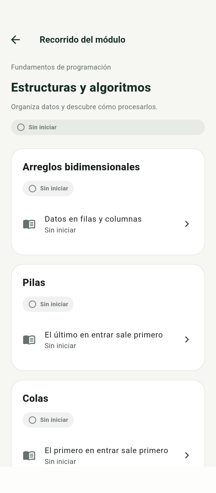
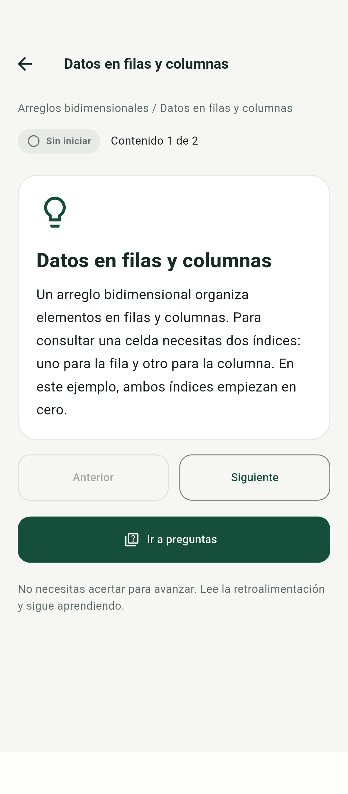
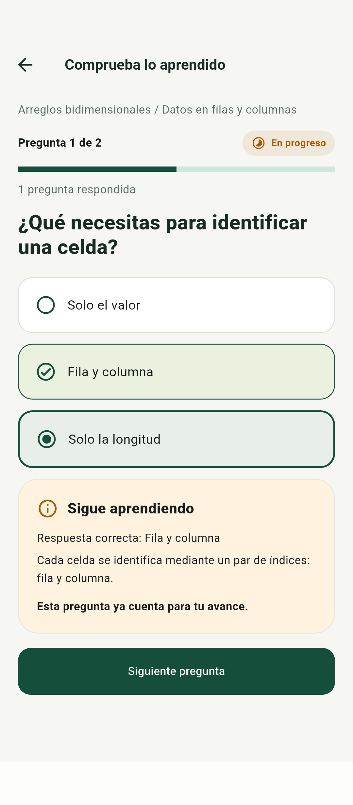
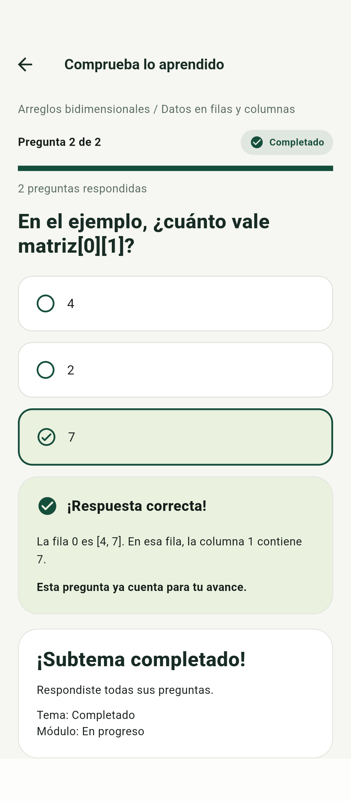
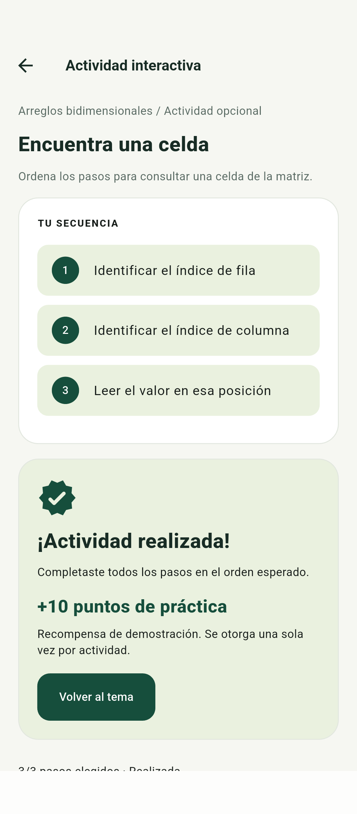
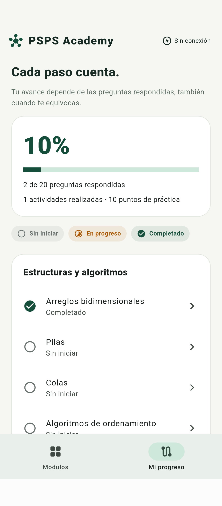

# Manual de usuario de PSPS Academy

Este manual te ayuda a estudiar los contenidos de Ingeniería de Software, practicar y consultar tu avance. La app guarda tu recorrido en el teléfono y funciona sin conexión una vez instalada.

Versión del manual 1.0 · 5 de octubre de 2026
Aplicación 0.1.0+1 · Incremento del Sprint 1
Dirigido a estudiantes · Android verificado en modelo 24049RN28L con Android 16

## Qué encontrarás en la app

La versión actual contiene cuatro módulos, diez temas, veinte preguntas y diez actividades opcionales. Puedes entrar a los contenidos disponibles desde Módulos; no necesitas crear una cuenta ni iniciar sesión.

| Elemento | Cómo utilizarlo |
|---|---|
| Módulos | Elige un módulo, un tema y el subtema que quieres estudiar. |
| Mi progreso | Consulta preguntas respondidas, estados de los temas, actividades y puntos. |
| Contenido y ejemplos | Lee la explicación y cambia de página con Siguiente o Anterior. |
| Preguntas | Selecciona una opción y pulsa Comprobar para ver la explicación. |
| Actividad interactiva | Ordena los elementos; se completa automáticamente al acertar la secuencia. |

## Antes de empezar

1. Instala la versión Android siguiendo la Guía de operación incluida en el repositorio.
2. Abre PSPS Academy desde la lista de aplicaciones del teléfono.
3. Entra a Módulos y elige el contenido que deseas estudiar. Desliza la pantalla si un elemento queda fuera de la vista.

Los contenidos y los diez puntos por actividad son provisionales. Esta versión permite consultar puntos y actividades; los logros e insignias y los desbloqueos aún no están disponibles. iOS no fue verificado en esta entrega.

## Explorar y estudiar un subtema

1. En Módulos, toca Estructuras y algoritmos u otro módulo disponible.
2. Elige un tema; por ejemplo, Arreglos bidimensionales. Después toca el subtema Datos en filas y columnas.
3. En la pantalla del tema, pulsa Estudiar subtema. Lee la explicación.
4. Pulsa Siguiente para ver el ejemplo y Anterior para regresar a la explicación.
5. Pulsa Ir a preguntas cuando quieras responder. Puedes volver con la flecha superior izquierda o el control Atrás de Android.

Leer, cambiar entre contenido y ejemplo o consultar los temas no aumenta el avance. El progreso se registra cuando compruebas una respuesta.

Las imágenes son capturas reales de la ejecución Android del 10/10/2026. Los valores mostrados pertenecen a un recorrido de prueba.

## Responder preguntas y revisar la explicación

1. Selecciona una opción. Comprobar se habilita después de elegirla. Antes de comprobar, puedes cambiar tu selección.
2. Pulsa Comprobar. Si aciertas, aparece ¡Respuesta correcta!; si te equivocas, aparece Sigue aprendiendo con la opción correcta y la explicación.
3. Lee la retroalimentación y pulsa Siguiente pregunta. Al terminar, usa Volver al contenido. Pregunta anterior permite revisar una pregunta previa.

Una respuesta incorrecta también cuenta como respondida. Al responder todas las preguntas aparece ¡Subtema completado! El tema se completa con todos sus subtemas y el módulo con todos sus temas.

Después de Comprobar, esta versión conserva la respuesta original y permite consultarla; no puedes sustituirla por otra. Revisarla no aumenta otra vez el conteo.

## Realizar una actividad interactiva

1. Desde la pantalla de un tema, pulsa Realizar actividad.
2. Lee la instrucción y toca los elementos disponibles en el orden que consideres correcto. Los elementos seleccionados pasan a Tu secuencia.
3. Si deseas corregir el orden, toca un paso elegido para retirarlo y selecciona los elementos nuevamente. Si completaste una secuencia incorrecta, aparece Revisa la secuencia.
4. Cuando los tres pasos estén en el orden esperado aparece ¡Actividad realizada! y se registran diez puntos de práctica. Pulsa Volver al tema para regresar.

No necesitas pulsar un botón Finalizar. La recompensa se otorga una sola vez por actividad. Después podrás abrir Consultar actividad realizada; volver a consultarla no duplica los puntos. Las actividades son opcionales y no condicionan la finalización de los contenidos.

## Consultar y conservar tu progreso

Toca Mi progreso en la barra inferior. Verás el porcentaje global, las preguntas respondidas de un total de veinte, las actividades realizadas y los puntos de práctica. Los estados se muestran con texto, ícono y color.

| Estado | Significado |
|---|---|
| Sin iniciar · gris | Ninguna pregunta de ese contenido está respondida. |
| En progreso · naranja | Hay al menos una pregunta respondida y alguna pendiente. |
| Completado · verde | Todas las preguntas de ese contenido están respondidas. |

El guardado es automático al comprobar una respuesta o cambiar la secuencia de una actividad. Puedes cerrar y reabrir la app; recuperarás el último estado guardado. El avance pertenece a este teléfono: no se sincroniza con otro equipo ni con una cuenta.

## Resolver problemas frecuentes

| Situación | Qué hacer |
|---|---|
| Comprobar está deshabilitado | Selecciona una opción. Si aparece Guardando…, espera a que termine. |
| El avance no cambia al leer | Es el comportamiento esperado. Comprueba una respuesta para registrar avance. |
| La actividad no se completa | Revisa la secuencia, retira un elemento elegido y acomódalo de nuevo. |
| No se pudo guardar el cambio. Intenta de nuevo. | Repite la misma acción. El cambio fallido no se presenta como guardado. |
| No pudimos recuperar tu avance… | Pulsa Reintentar. Si el error continúa, conserva los datos y repórtalo al equipo. |
| No veo logros o insignias | Esa función no está implementada en el incremento actual. |

## Cuidar el avance guardado

Evita desinstalar la app o borrar sus datos si quieres conservar el recorrido. Esta versión no tiene respaldo ni recuperación desde un servidor. Al cambiar de teléfono, el progreso no se traslada automáticamente.

No hay un botón de reinicio del progreso. Si necesitas empezar desde cero, consulta primero al equipo; borrar datos o desinstalar puede eliminar respuestas, actividades y puntos.

## Solicitar ayuda

Comunica la versión de la app, el modelo y versión de Android, la pantalla donde ocurrió el problema, los pasos realizados y el mensaje exacto. Incluye una captura de la pantalla de la app si ayuda a entenderlo.

Canal del proyecto: https://github.com/XlayersCeboso99/TSP_PSPS/issues

## Documentos relacionados

La Guía de operación explica instalación y mantenimiento. WP.14 contiene los casos ejecutados y las capturas; WP.15 registra los resultados y pendientes. La validación final del manual y de la guía con el equipo y la cliente está pendiente.
